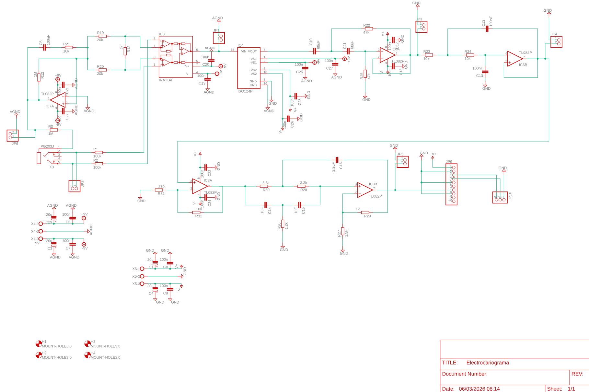
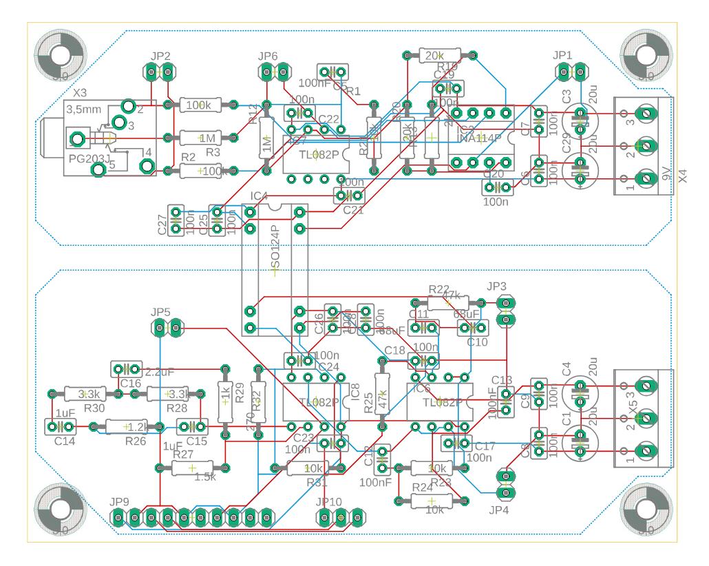

# ❤️ Custom ECG Acquisition System

A medical-grade Electrocardiogram (ECG) acquisition system featuring a custom analog front-end with galvanic isolation, 16-bit digitization, ESP32 processing, and MATLAB visualization.

---

## 📸 Project Gallery

### ⚡ Hardware Showcase

| 🛠️ Soldered & Assembled PCB | 🎛️ Top Interface / Buttons |
| :---: | :---: |
|  |  |

### 🖥️ Engineering Design (PDF Export)

| 📦 PCB Layout | 📐 Schematic Diagram |
| :---: | :---: |
|  |  |

---

## ⚡ System Architecture

```text
ECG Electrodes ➔ Analog Front-End ➔ ISO124 Isolation ➔ ADS1115 ADC ➔ ESP32 MCU ➔ MATLAB
```

The **ESP32** reads high-resolution differential data from the ADS1115 via I2C and streams it over Serial to MATLAB for real-time digital filtering and analysis.

---

## 🧠 Hardware Features

*   **Amplification & Filtering:** High-common-mode rejection ratio using **INA114** and active filtering with **TL082**.
*   **Galvanic Isolation:** Critical patient safety stage using the **ISO124** linear isolation amplifier.
*   **Precision Digitization:** External **ADS1115** 16-bit ADC for low-noise biopotential conversion.

---

## 📁 Repository Structure

*   📁 **`code/`**: ESP32 firmware for high-speed data acquisition.
*   📁 **`hardware/`**: Native CAD design files (`.sch` and `.brd`).
*   📁 **`figures/`**: Visual documentation, pictures, and export PDFs.
