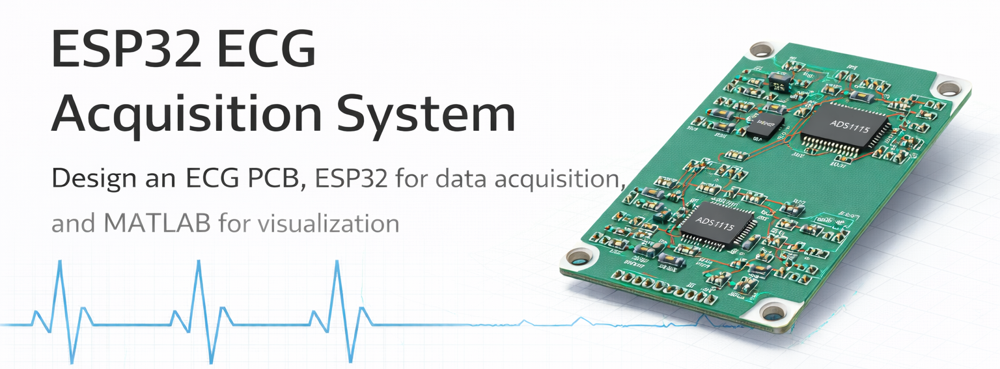
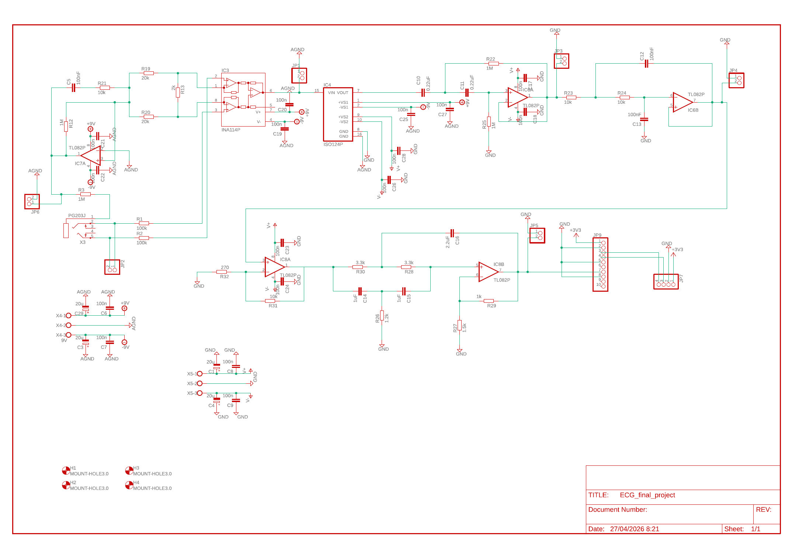
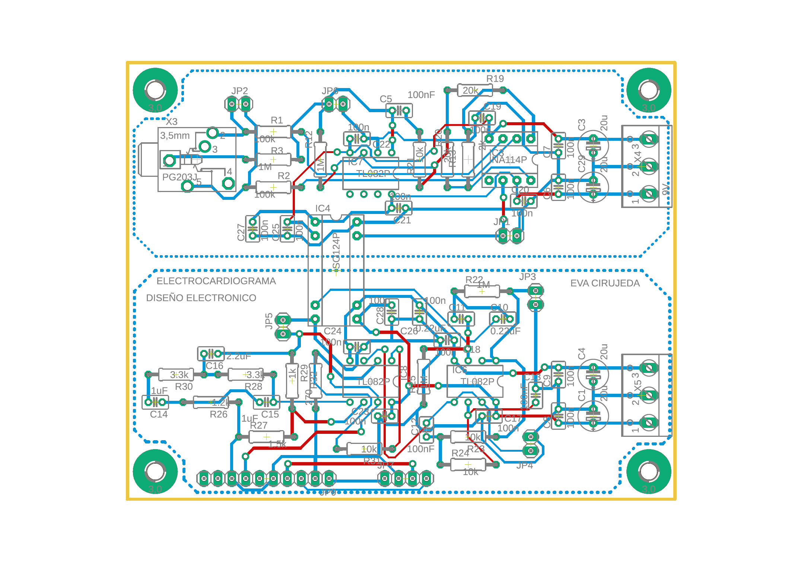
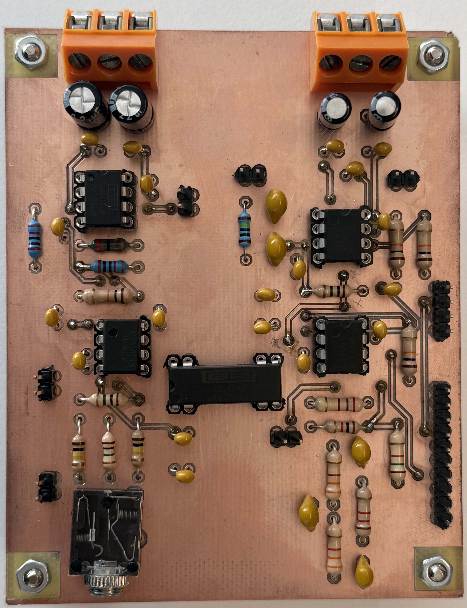
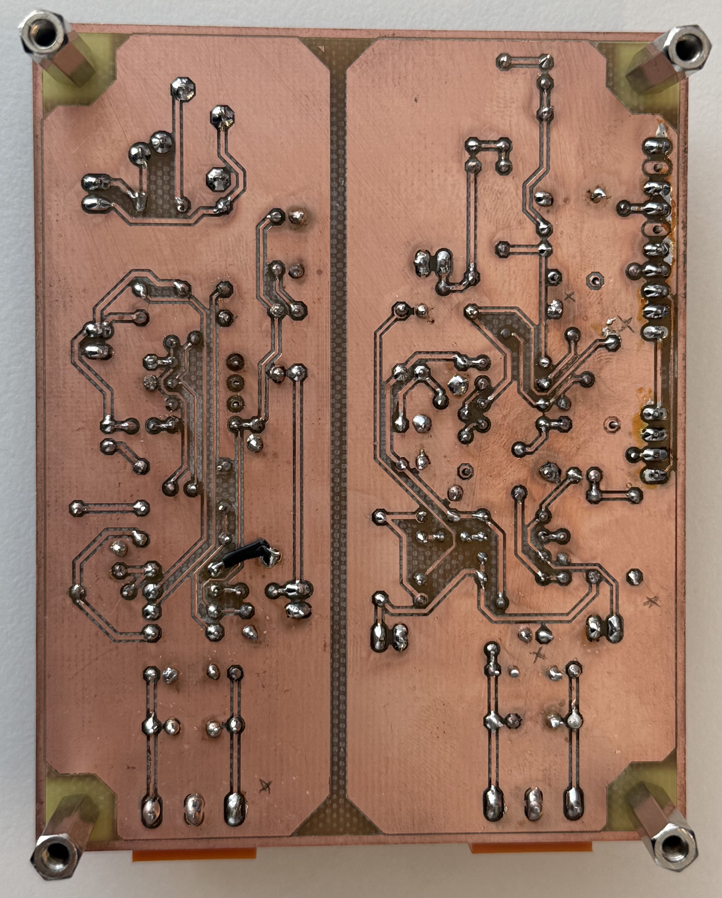

# ❤️ Custom ECG Acquisition System

<p align="center">
  
</p>

Design of a custom electrocardiogram (ECG) acquisition system including a dedicated analog front-end PCB with galvanic isolation, ESP32-based signal acquisition, and MATLAB visualization for cardiac signal analysis.

---

## ⚡ System Architecture

The acquisition chain is structured as follows:

```text
ECG Electrodes ➔ Analog Front-End PCB ➔ ADS1115 ADC ➔ ESP32 Microcontroller ➔ MATLAB Visualization
```

<p align="center">
  
</p>

The ESP32 reads the differential ECG signal from the ADS1115 and streams the data via serial communication for external visualization and processing.

---

## 🧠 Hardware Design

The system includes a custom PCB designed to acquire and condition the ECG signal.

Main hardware components:
- **INA114 & TL082:** Instrumentation amplifier and operational amplifiers used for high-common-mode rejection amplification and active analog filtering stages.
- **ISO124:** Linear isolation amplifier providing a critical galvanic isolation stage to guarantee patient safety against electrical shocks.
- **ADS1115:** High-precision 16-bit ADC used to digitize the conditioned analog ECG signal with low noise.
- **ESP32 Interface:** Microcontroller connection layer responsible for sampling the ADC data over I2C and managing high-speed serial communication.

<p align="center">
  
</p>

---

## 🛠️ Assembled Hardware & Soldering Showcase

Visual inspection of the final, fully assembled and soldered printed circuit board:

| Top Layer Assembly | Bottom Layer Soldering |
| :---: | :---: |
|  |  |
| *Top view showing component placement and active ICs.* | *Bottom view showing the final solder joints and trace routing.* |

---

## 📁 Engineering Blueprints & Documentation

The native CAD design files are available directly in the root of the repository:

*   🛠️ **[View PCB Layout File (.brd)](ECG_final_project.brd)**
*   📐 **[View Schematic Diagram File (.sch)](ECG_final_project.sch)**
